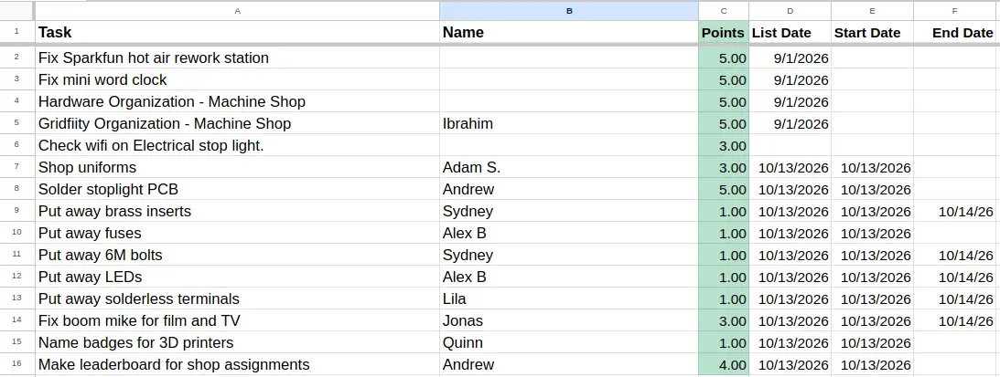

# MVTHS Robotics Task Leaderboard

taskboard for the mvths engineering shop that tracks the amount of tasks you have completed and the amount of points you recieved for the tasks. tasks are tracked in a  google sheet which lists the start date, finish date, points, task, and who is completing the task. whenever the sheet updates, the leaderboard updates as well. 

static site—it's a published csv sheet that is pulled from the browser and computes all the scores on the client, repolling every few seconds


## features

- **live updates** — the page polls the published sheet every 5 seconds, so
  scores refresh almost immediately after the sheet changes.
- **rankings** — sort by total points or completed tasks, filter by timeframe
  (24h / 5d / 30d / all time) and grade, and search across every name.
- **per-student breakdown** — expand any row to see every task: its dates and
  points, with any grade bonus noted underneath.
- **mobile friendly** — responsive layout, compact detail view, and
  tap-to-expand on small screens.
- **shop tasks page** — `/tasks/` lists every task; students can claim an
  open task, mark a claimed task done, and reclaim a task that has sat
  unclaimed for a while (see [claiming tasks](#claiming-tasks)).

## scoring 

the amount of points given per task is based on what the teachers (mr. christy and mr. l) deem as appropriate. harder to finish tasks (such as fixing / making something) will always be worth more than sorting / putting items away. 

in addition, to incentivize underclassmen to do more tasks, there are additional point bonuses based on your grade:

+0.2 points for sophomores and +0.1 points for juniors

## tech stack

- **vanilla JS + css**, no build step, no dependencies
- **google sheets** published CSV export
- **5s client-side polling** (no backend, no SSE, no server)
- **google apps script** web app for writes (claim/done), optional

## claiming tasks

`/tasks/` lets students update the sheet from the browser:

- **claim** — an unclaimed task shows a `claim` button. Clicking it asks for a
  name, then writes the name and today's date into the `Name` / `Start Date`
  columns.
- **done** — a claimed task shows a `done` button that writes today's date into
  the `End Date` column.
- **reclaim** — if a task has been claimed for more than 10 days, a `reclaim`
  button appears (hover the days counter on desktop) to reassign it.

These writes go through a Google Apps Script Web App (`apps-script/Code.gs`),
since the browser can't edit a sheet directly. To set it up:

1. Open the sheet → **Extensions → Apps Script**.
2. Paste the contents of `apps-script/Code.gs`. Adjust `SHEET_ID` / `SHEET_NAME`
   if needed.
3. **Deploy → New deployment → Web app**. Set *Execute as: Me* and *Who has
   access: Anyone*, then deploy and copy the `/exec` URL.
4. Paste that URL into `TASKS_API_URL` at the top of `docs/js/tasks.js`.

If `TASKS_API_URL` is empty, the tasks page still works as a read-only view
but clicking claim/done shows a setup reminder.

## getting started (if you want to make something like this as well)
view `docs/js/scoring.js` and change whatever needs to be changed. (sheet url, grades, websites, bonus points, etc.)

format a google sheet like the image below:


## starting the server 
```bash
cd task-leaderboard/docs

# serve the folder (any static server works)
python3 -m http.server 8000
```

open <http://localhost:8000>. the leaderboard is at `/` and the shop tasks
page is at `/tasks/`.
